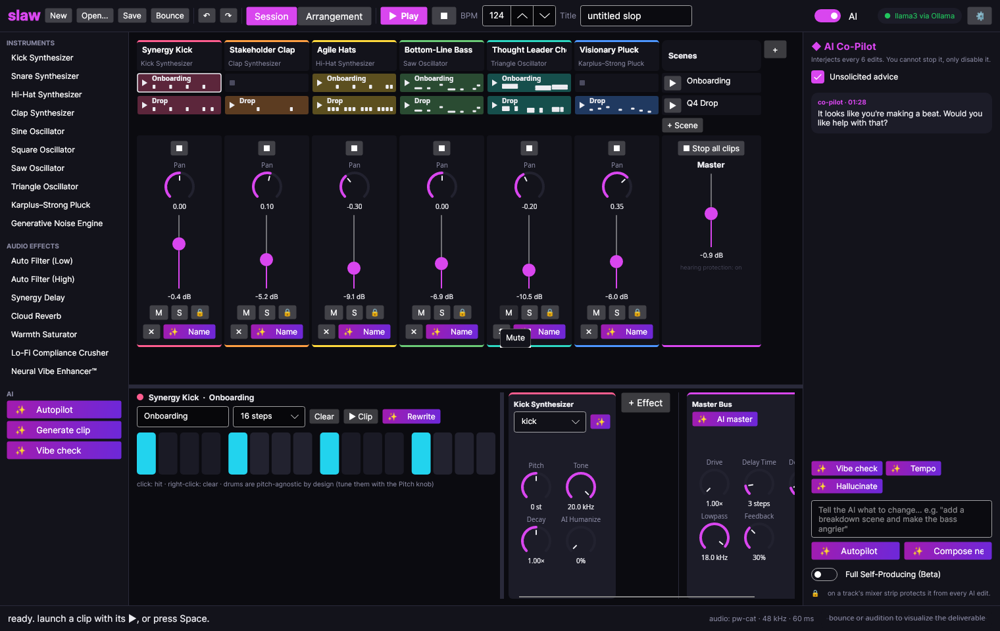

# slaw
### *Beyond Deterministic Production*

> "We didn't reinvent the DAW. We asked an AI to guess what music sounds like."
> — slaw Engineering Blog, Issue 1 (Final)

**slaw** is a next-generation, AI-native, LLM-first digital audio workstation that leverages the full generative power of large language models to holistically transform your *vibe* into an audible waveform artifact — at inference speed, across every major foundational intelligence provider in the ecosystem.

Traditional DAWs are slow, opinionated, and constrained by decades of musical thinking. They have timelines. They have plugins. They expect you to know what a compressor does. slaw moves production to the inference layer, reasoning about your *intent* rather than your *arrangement* — eliminating the pedantic intermediate steps (rhythm, melody, taste) that have constrained the music production lifecycle for decades. The bottleneck is no longer your sound design. It's your willingness to hit play.

**Key differentiators:**
- Zero determinism — every bounce is a unique stakeholder experience
- Multi-provider intelligence substrate — route your production intent through Ollama, OpenAI, Google Gemini, Anthropic Claude, or any OpenAI-compatible server
- Zero samples shipped — everything is synthesized, because samples would imply someone recorded something on purpose. (Bring your own WAVs via the `sampler`. They are yours, and therefore your responsibility.)
- Blazing-fast time-to-tinnitus
- Clipping-as-a-feature architecture, responsibly neutralized by the hearing protection substrate
- Model-native waveform synthesis unconstrained by legacy notions of "audio format"
- Agentic arrangement pipeline (`--optimistic`) for synergistic human-AI co-production
- A native, Ableton-style session-view studio: clips, scenes, mixer strips, device chains, and an arrangement timeline, none of which you asked an AI to understand
- **Live editing**: a real-time engine streams audio continuously, so every note, knob, and whole-song AI rewrite is heard on the next step with no restart
- **AI Autopilot**: hand the model the entire project and an instruction, receive a full rewrite and a change summary. Tracks marked 🔒 *Protect from AI* are restored verbatim, because boundaries matter
- **Full Self-Producing (Beta)**: the Autopilot, in a loop, until you intervene
- An unsolicited AI co-pilot that interjects every few edits, on by default
- **You can turn the AI off.** Nobody at slopstack labs has ever turned it off
- Undo/redo for everything, including the AI's decisions
- AI mastering, AI tempo negotiation, AI track naming, and AI vibe checks by a world-renowned LinkedIn thought leader
- Fully on-premise inference available — your data, your model, your noise
- Radical shift-left audio delivery: bypass intermediate music theory layers and ship directly to the speakers

**slaw is the only DAW built on the insight that your track doesn't need to be *good* — it needs to be *shipped*.**

## Roadmap

See the [Circle of Fifths of Inevitability](ROADMAP.md).

## Contributing

See the [Contributor Excellence Framework](CONTRIBUTING.md).

## Platform support

slaw runs natively on **Linux, macOS, and Windows**. It is written in C# on .NET 8, and the studio is a desktop application built with [Avalonia](https://avaloniaui.net) 11.3, a cross-platform .NET UI toolkit. The UI is composed entirely in C# with no XAML, because declarative markup is a legacy constraint inherited from a less agentic era.

Dependencies: zero beyond the UI toolkit. Every sample is synthesized, every HTTP call is hand-rolled, and the synth engine and WAV writer are pure base class library.

`slaw play` auditions audio through whatever your host provides:

| Host | Player |
|------|--------|
| Linux | `pw-play`, `paplay`, `aplay`, or `ffplay` (first one found) |
| macOS | `afplay` |
| Windows | PowerShell `Media.SoundPlayer` |

The studio does not use these. It runs its own live engine and streams audio continuously to your host's audio substrate (`pw-cat`, `pacat`, `aplay`, or sox `play` on Linux/macOS; winmm waveOut on Windows).

## Requirements

- .NET 8 SDK to build
- **For the studio on Linux:** a desktop session (X11 or XWayland). The headless commands (`compose`, `render`, `play`, `master`, `vibe`, `new`) work anywhere, including CI/CD.
- **For `--provider=local`:** [Ollama](https://ollama.com) running locally with a model pulled
- **For `--provider=openai|google|claude`:** a valid API key surfaced via `--api-key` or the `SLAW_API_KEY` environment variable
- **For `--provider=compat`:** any OpenAI-compatible server (LM Studio, llama.cpp server, vLLM, OpenRouter, Groq, Mistral, ...) and its `--base-url`

## Build

```sh
dotnet build -c Release
```

Single-file binary:

```sh
dotnet publish src/Slaw -c Release -r linux-x64 --self-contained -p:PublishSingleFile=true -o out
```

Supported runtime identifiers: `linux-x64`, `linux-arm64`, `osx-x64`, `osx-arm64`, `win-x64`. Release assets are named `slaw-linux-x64`, `slaw-linux-arm64`, `slaw-osx-x64`, `slaw-osx-arm64`, and `slaw-win-x64.exe`. Each is a single-file executable that is both the desktop studio and the CLI.

Or use the helper script for your shell, which builds if needed, starts Ollama, pulls the model, and runs slaw. With no arguments it opens the `studio` window:

```sh
# Linux / macOS
./run.sh [slaw args...]
MODEL=phi3 ./run.sh compose "lofi beat for productivity"
```

```powershell
# Windows
./run.ps1 [slaw args...]
$env:MODEL = "phi3"; ./run.ps1 compose "lofi beat for productivity"
```

The default `MODEL` is `llama3`.

## Usage

```sh
slaw                        # opens the desktop studio
slaw <command> [options]    # headless production pipeline
```

| Command | Description |
|---------|-------------|
| `slaw` / `slaw studio [project.slaw]` | Opens the desktop session-view studio window. Opens or creates the project. Add `--view arrangement`, `session`, or `sample` to choose the starting view. |
| `slaw compose "<vibe>" [-o out]` | Ask the model to produce audio from a vibe. Default mode writes `slop.wav`. |
| `slaw render <project.slaw> [-o out.wav]` | Deterministic offline bounce to 16-bit 44.1 kHz stereo WAV. |
| `slaw play <project.slaw\|file.wav>` | Render (if needed) and audition through the host player. |
| `slaw master <project.slaw> [-o out.slaw]` | AI mastering: the model chooses the master chain, saved into the project and bounced to WAV. |
| `slaw vibe <project.slaw>` | Vibe check. Returns `VIBE SCORE: N/10` and a short critique. |
| `slaw autopilot <project.slaw> "<instruction>"` | Headless Autopilot: the model patches the project, and the change summary is printed. Saves in place, or to `-o`. |
| `slaw import <song.mid> [-o song.slaw] [--soundfont font.sf2\|none]` | Convert a Standard MIDI File into a slaw project, voiced with the SoundFont next to it (or the one given; `none` for built-in instruments). |
| `slaw mcp [project.slaw]` | Serve the project to MCP clients (Claude Code, …) over stdio, autosaving every edit. |
| `slaw new [project.slaw]` | Scaffold a starter project (default `untitled.slaw`). |

| Flag | Default | Description |
|------|---------|-------------|
| `--provider` | `local` | Intelligence provider to route production intent through: `local`, `openai`, `claude`, `google`, `compat` |
| `--api-key` | — | API key for the selected provider (required unless `local` or `compat`; or set `SLAW_API_KEY`) |
| `--model` | provider-specific | Model to use (defaults: `llama3` / `gpt-4o` / `claude-opus-5-5` / `gemini-2.5-flash` / `default` for `compat`) |
| `--ollama` | `http://localhost:11434/api/generate` | Ollama API URL (only honoured with `--provider=local`) |
| `--base-url` | — | Base URL for `compat` (e.g. `http://localhost:1234/v1` for LM Studio), or to override `openai` |
| `-o` | see command | Output path |
| `--optimistic` | false | `compose`: engage agentic arrangement co-pilot |
| `--loop N` | 0 | `compose`: re-align LLM outputs with ground truth up to N times on JSON parse failure |
| `--force-iterate N` | 0 | `compose`: proactively enhance output quality for N cycles even on success |
| `--mcp` / `--mcp-port N` | off / `47115` | `studio`: expose the open project over MCP (HTTP on 127.0.0.1) |
| `--plugin-folder DIR` | — | `studio`, `mcp`: also scan `DIR` for VST3 plugins this session (repeatable; or set `VST3_PATH`) |
| `--view` | `session` | `studio`: starting view, `session`, `arrangement` (`free` still works, for stakeholders attached to the old name), or `sample` (the first sampler's editor) |
| `--no-copilot` | false | `studio`: disable the unsolicited AI co-pilot (why would you). Flags override saved Settings for one session |
| `--timeout N` | 300 | HTTP request timeout in seconds per LLM call (`0` = no timeout) |
| `--verbose` | false | Verbose debug output |

## Examples

`examples/` holds the reference portfolio. Everything below is built from slaw's own instruments and effects: **no VST3 plugins, no samples, no SoundFonts**. Clone, open, render. Every song lives on the arrangement timeline, and each bounce peaks below -1.5 dBFS without waking the hearing protection substrate, which has asked for more meetings like these.

```sh
slaw studio examples/stakeholder-pump.slaw     # open it
slaw render examples/stakeholder-pump.slaw     # or bounce it, writes stakeholder-pump.wav next to it
```

| File | What it is |
|------|------------|
| `synergy-feature-tour.slaw` | **Start here.** 24 bars at 120 BPM, one of each newer feature, and every track name says which. Sidechain: the sub ducks under the kick, and the pad is gated by a *muted* ghost kick. Envelopes: pad filter sweep (`fx.0.cutoff`), arp `inst.brightness`, hat `pan`, lead `pitch` scoop and dive, riser `gain`/`pitch`/filter, a clap reverb throw (`fx.0.mix`). Notation: chords (`+`), velocities (`@`), note lengths (`:n`), holds (`_`). The master chain carries highpass, drive and widen (see the Master Bus device). The session's two scenes are jam clips: launch them while the arrangement plays, then ⤺ Back to Arrangement |
| `stakeholder-pump.slaw` | Club house, 124 BPM, A minor, 56 bars. Dry offbeat organ and piano stabs, a bouncy bass and a rhythmic saw hook, all pumping off the kick. Filter-sweep intro and build, snare roll, riser, crash, and delay and reverb used as throws at the transitions only |
| `escalation-velocity.slaw` | Drum and bass, 174 BPM, F minor, 120 bars. **Look here for ratchets and `spread`.** A two-step kick and snare with `@` ghost notes, 16th hats that flourish in `x*2` and `x*3`, fills that end in `x@0.7*4`, and a build roll that escalates `x` → `x*2` → `x*4` → `x*8` without adding a single step to the sprint. The Reese is a saw at `spread` 22. Its lowpass wobbles every bar, and in the VIP drop an `inst.spread` envelope widens it from 8 to 50 cents. In the breakdown it holds one note per chord while the spread opens from 1 to 50, so you can hear the beating arrive. The sine sub ducks under the kick and slides down a fifth (`pitch` envelope) into each new phrase. Reverb and delay are used only as throws and as breakdown atmosphere |
| `quarterly-earnings-house.slaw` | Bassline house, 140 BPM, E minor, 56 bars. The autopilot's original wobble riff and gallop, rebuilt: the wobble is a cutoff envelope, the two Casio samplers that used to live on one engineer's disk are now a triangle *Touch Bass* and a sine *Melodic Tom*, and the A minor outro chord survives as filed |
| `synergy-season-instrumental.slaw` | Pop, 104 BPM, G major, 64 bars. The sung vocal is now a synthesized lead line, the plugin pad and guitar are a detuned saw pad and a pluck, and the pad pumps off the kick through a duck instead of a hand-drawn gain envelope |
| `garden-leave.slaw` | Downtempo, 84 BPM, D major, 40 bars. Long envelopes: 8- and 16-bar filter swells, drifting pan, keys that brighten over 16 bars, a 40-bar tape hiss, and a tape-stop pitch dive at the end |
| `headcount-reduction.slaw` | Riddim, 150 BPM, 30 bars. Restructured to fit under the ceiling |
| `synergy-drop.slaw` | Dubstep, 140 BPM, 15 bars. Wobble, growl and a riser that now reaches the audience |
| `synergy-lofi.slaw` | Lo-fi, 78 BPM, 4 bars. The smallest possible deliverable |

The exception requires outside resources: `showcase-full-stack.slaw` needs VST3 plugins (OB-Xf, Kars, MVerb and friends from `/usr/lib/vst3`) and a recorded vocal sample. It is the full-stack offering; procurement is your responsibility. Rendered `.wav` files are ignored by git, so bounce your own.

## Production Modalities

Everything in this section is the **headless production pipeline for CI/CD-native music delivery**: no window, just terminal spinners and a `.wav` at the end of the pipeline.

### Core Mode — *Frictionless Waveform Ideation*

Instructs the model to emit a WAV file as a hex string, primed with `52494646` ("RIFF"). slaw then discards whatever header the model wrote, synthesizes a compliant RIFF header, interprets the bytes as 8-bit unsigned PCM at 8 kHz, and engages the temporal upscaling substrate to loop the result to at least 4 seconds. Output goes to `slop.wav`. This is our flagship zero-abstraction, direct-to-tinnitus pipeline.

```sh
# Local inference via Ollama
slaw compose "lofi beat for productivity" --model phi3

# Leverage frontier intelligence for accelerated waveform misalignment
slaw compose "synergy anthem" --provider openai --api-key $OPENAI_API_KEY
slaw compose "synergy anthem" --provider claude --api-key $ANTHROPIC_API_KEY
slaw compose "synergy anthem" --provider google --api-key $GEMINI_API_KEY

# Any OpenAI-compatible server
slaw compose "synergy anthem" --provider compat --base-url http://localhost:1234/v1

slaw play slop.wav
```

### Optimistic Mode (`--optimistic`) — *Agentic Arrangement Co-Pilot*

Engages the model as an arrangement partner. It emits a structured `.slaw` JSON project, which slaw remediates (clamping values, mapping hallucinated instruments such as "warm analog bass" to `saw`, padding patterns) and bounces through the real synth engine. Writes `slop.slaw` and `slop.wav`.

```sh
slaw compose --optimistic "uplifting corporate house" --provider openai --api-key $OPENAI_API_KEY
```

### Loop Mode (`--loop N`) — *Closed-Loop Arrangement Remediation*

When the arrangement fails to parse, the error is fed back to the model for up to N self-correction cycles.

```sh
slaw compose --optimistic --loop 5 "lofi beat" --provider claude --api-key $ANTHROPIC_API_KEY
```

### Force Iterate Mode (`--force-iterate N`) — *Continuous Improvement Pipeline*

Engages N improvement cycles even on success. A working arrangement is a starting point, not an endpoint.

```sh
slaw compose --optimistic --force-iterate 3 "lofi beat" --model phi3
```

### Render Mode — *Legacy Compliance Mode*

`slaw render` performs a deterministic offline bounce of a `.slaw` project to 16-bit 44.1 kHz stereo WAV. It is the only deterministic component in slaw, retained for regulatory compliance.

```sh
slaw render song.slaw -o song.wav
```

### Mastering and Vibe Check

`slaw master` has the model choose the master chain (`gain`, `drive`, `lowpassHz`, `delaySteps`, `delayFeedback`, `delayMix`) along with a written rationale, which is saved into the project. `slaw vibe` returns a vibe score from "a world-renowned producer and LinkedIn thought leader".

```sh
slaw master song.slaw -o song-mastered.slaw
slaw vibe song.slaw
```

The master chain is: feedback delay, one-pole lowpass, `tanh` saturation, gain, and finally the **hearing protection substrate**, a live peak limiter at roughly -1 dBFS that no model or prompt can raise. Hallucinated audio is additionally played at reduced level.

## The Studio

`slaw` (or `slaw studio [project.slaw]`) opens a **session-oriented desktop DAW** on Linux, macOS, and Windows. It is built with Avalonia 11.3 and composed entirely in C#, with no XAML. The layout will be familiar to anyone who has used Ableton Live, and unfamiliar to anyone who has used a compressor. Before any inference has occurred, the AI co-pilot greets you with a hard-coded "It looks like you're making a beat. Would you like help with that?" line.

### The live engine

A real-time, sample-accurate sequencer runs in-process and streams audio continuously (Linux and macOS via a pipe into `pw-cat`, `pacat`, `aplay`, or sox `play`; Windows via the winmm waveOut API). **Every edit is heard on the next step, without stopping or restarting playback**: a note, a knob, the BPM, a mute, or an AI rewriting the entire song. The same engine renders offline bounces, so what you hear is what you export. The **hearing protection substrate** is now a live peak limiter at about -1 dBFS.

### Window layout

- **Menu bar** (top): **File** (new, open, save, import MIDI, bounce, show the last bounce in its folder, settings), **Edit** (undo/redo naming what they undo, cut/copy/paste, duplicate, delete), **Create** (tracks, audio track, scenes, clips, a new AI chat), **View** (Session / Arrangement, computer keyboard, and show/hide the browser, the clip & devices panel and the AI panel), **Help** (shortcuts). Every item shows its shortcut; menus and keys run the same commands.
- **Toolbar** (below it): Play/Stop (plus **⤺ Back to Arrangement** while session clips play over the song), BPM, **Swing** (50 straight to 75; see **Groove**), project title, the **Session / Arrangement** switch, a master **AI** switch, Settings (⚙), and a status chip showing the inference substrate ("● llama3 via Ollama" or "○ AI offline").
- **Session view**: tracks are columns, scenes are rows. Each cell is a clip slot with a ▶ launch triangle; empty slots show a stop square, and double-clicking one creates a clip. Launches are **quantized to the next bar**, like a real DAW. The right-most column launches whole scenes (▶ per scene, editable scene names; right-click for *place in arrangement at cursor*, *duplicate*, *delete*) and holds the master fader and **Stop all clips**. Every track column ends in a **mixer strip**: stop button, pan knob, vertical volume fader with dB readout, Mute / Solo, a 🔒 **Protect from AI** lock, delete, and "✨ Name" (AI rename).
- **Arrangement view**: the song, as one timeline with a lane per track. Clips sit at any step, at any length. See **Arrangement** below.
- **Detail view** (bottom): the clip editor. Melodic tracks get a polyphonic **piano roll** (click to add notes or chords, drag right to hold, click a note to select it, double- or right-click to delete, wheel or ▲▼ to scroll octaves); drums get a step row. Ratchet steps (`x*3`) show as a hit cut into that many slices, in the step row and in the piano roll. A **Velocity** slider above the editor sets how hard the selected note or hit is struck. The keyboard strip along the left edge is playable: see **Note audition** below. Clip name, clip length (4-64 steps), Clear, ▶ Clip, and "✨ Rewrite" sit alongside. Next to the editor is the **device chain**: a small **Groove** device (the track's own Swing, empty to follow the song's, with ↺ to hand it back, and a **Timing** humanize knob in ms), the instrument device with knobs (oscillators: Attack, Decay, Sustain, Release, Filter, Octave, Detune, Spread (unison detune), AI Humanize; noise the same without Spread; pluck: Length, Brightness, …; drums: Pitch, Decay, Tone, AI Humanize), then audio effects with knobs, on/off, reorder, remove, a **Sidechain** picker where the effect listens to one, and **+ Effect**, and finally the **Master Bus** device (Drive, Lowpass, Delay time/feedback/mix, "✨ AI master") followed by the master chain's own effects and **+ Master FX**. Knobs the AI changed glow violet until you touch them.
- **Browser** (left): instruments (click to add a track) and effects (click to add to the selected track), your **VST3 plugins**, your **Samples** (see **Your own samples**), and the AI actions. Click a section heading (▾/▸) to fold it away; slaw remembers which are folded.
- **AI panel** (right, AI on): the co-pilot transcript and the Autopilot chat box. See below.

Closing the window with unsaved changes is intercepted by the co-pilot on the first attempt ("close again to abandon your artistic vision").

### Groove: swing and timing

The grid is a strong default, not a performance review. Two settings loosen it without touching a single pattern:

| Setting | Where | Units | What it does |
|---|---|---|---|
| **Swing** | project `swing` (toolbar), overridable per track (`tracks[].swing`, the Groove device) | percent of an eighth note, 50–75 | MPC-style: every odd sixteenth (steps 1, 3, 5 … counted from the start of the song, not of the clip: the second of each eighth-note pair) starts (swing − 50) / 50 of a step late. 50 is straight, 58 a light shuffle, 66.67 a triplet shuffle (⅓ step late), 75 a dotted-sixteenth limp (½ step). A track's own swing wins, so the hats can shuffle over a four-on-the-floor kick that stays straight; `null` (an empty box) follows the song |
| **Timing** | `tracks[].timing`, the Groove device's knob | milliseconds, 0–50 | Every step the track plays starts a random 0..timing ms late (never early). The randomness is seeded, so a bounce of the same project is the same bytes every time; 8–15 ms reads as "played", 30 as "late for standup" |

Swing applies identically to session clips, arrangement clips, bounces and VST3 instruments (their note-ons and note-offs go out at sample offsets). Ratchet strikes spread evenly across their step's swung length, and a held note ends where the step after it really starts, so legato lines stay legato. Envelopes stay on the straight grid. Timing is a track setting rather than an instrument knob next to **AI Humanize** (which only humanizes loudness) because it belongs with swing: it is the track's feel, it survives switching instruments, and it works the same for samplers, SoundFonts and plugins. A project with swing 50 and no timing renders exactly the bytes it did before groove existed.

### Note audition

On the piano roll's keyboard strip, click and hold a key to hear that note on the track's instrument, through its effects. Drag along the keyboard to glide between notes. Releasing fades the note over the instrument's release time (drums and plucks ring out). Placing a note in the grid also previews it for as long as the mouse is held.

### Your own samples

The `sampler` instrument ("Sampler") plays your own WAV files, pitched across the piano roll. C4 is the root note by default, i.e. original pitch. Knobs: Root Note, Transpose, Start, End (trim), Note Length (off = one-shot, on = follows the note length), Reverse, Attack, Release, Gain, Filter, AI Humanize.

- **Format**: uncompressed WAV only. 8/16/24/32-bit PCM and 32/64-bit float, any channel count (mixed to mono), any sample rate. An MP3 in a WAV container is rejected with "format tag 0x55 looks like MP3 wearing a WAV costume".
- **Browser → Samples**: **+ Folder…** adds a sample folder, ⟳ rescans, and a filter box narrows the list by file or folder name ("909" keeps the whole pack). Samples are grouped by the folder they live in, labelled relative to the sample folder you added (*BPB Cassette 909 / clean*), so a pack's three `bd01.wav`s are no longer a single undifferentiated synergy. Folders start folded; slaw remembers which ones you opened. Click a sample to preview it; double-click to add it as a new sampler track (with a starter note so it is audible). Right-click for *add as new track*, *load into selected track*, or *preview*. Sample folders are also managed in Settings → Samples.
- **Drag and drop**: drop WAV files onto the window to create sampler tracks. One WAV dropped while an empty sampler track is selected loads into that track. Drop a folder to add it to the sample library.
- **Sampler device**: shows the sample's waveform, with **Load…**, ▶ preview, and **✨ Pick**, where an AI "sample curator" picks a sample from your folders for the track.
- **Autopilot**: is shown your sample library and may build sampler tracks from it. Hallucinated paths are matched by file name, or reverted.
- **Portability**: samples stored next to (or below) the project file are saved as relative paths, so project folders can be moved. Others stay absolute.

slaw itself still ships zero samples. These are yours, and therefore your responsibility.

### SoundFonts

The `soundfont` instrument ("SoundFont Player") plays one preset of a SoundFont 2 bank (`.sf2`): General MIDI sets, ringtone-grade phone fonts, sampled orchestras, whatever compliance has signed off on.

- **Loading:** **SoundFont… (.sf2)** in the browser adds a track; **Load…** in the device swaps the font on a track; or drop a `.sf2` onto a track (loads into it) or the window (new track). The device's preset picker lists every preset as `bank:program name`. Bank 128 is the drum kit: each MIDI note plays a different drum.
- **Knobs:** Gain, Transpose (semitones), Release (scales every zone's release), Filter, AI Humanize. Velocity, clip envelopes (including `pitch`, bent tape-style like the sampler) and the device chain work as on any track.
- **What is honoured:** key and velocity ranges, root key (and overridingRootKey), coarse/fine/scale tuning and pitch correction, loop modes (continuous and until-release) with every address offset, the delay/attack/hold/decay/sustain/release volume envelope (with keynum-to-hold/decay), initialAttenuation (scaled 0.4, as E-mu hardware and FluidSynth do), the zone's lowpass filter, and preset-level generators added on top of instrument ones.
- **What is not (yet):** the modulation envelope and both LFOs, modulators, chorus/reverb sends, exclusive classes, and stereo: zones render mono, and a stereo pair is summed at half level each. Zones are chosen at velocity 100; how hard a note is struck is applied as gain, like every other slaw instrument.
- **Loading behaviour:** fonts parse in the background; a note that arrives while its font is still loading is skipped, exactly like an undecoded sample. Bounces wait for the parse.
- **Portability:** a font next to (or below) the project file is saved as a relative path.

### MIDI

**MIDI input.** Every connected keyboard or controller plays the selected track:

- **Playing:** polyphonic and velocity-sensitive, through the track's own effects.
- **Knobs:** the mod wheel sweeps the instrument filter, CC7 sets volume, CC10 sets pan.
- **Platforms:**
  - **Linux:** the ALSA sequencer. slaw auto-connects to every MIDI source, including ones plugged in later, and appears as a `slaw` client so other software can play it (`aplaymidi -p slaw:0 song.mid`).
  - **Windows:** winmm.
  - **macOS:** not yet.
- **Turning it off:** Settings → Integrations.

**● Rec** records what you play into the selected clip:

- **While playing:** notes land on the step you hear, latency-compensated and quantized to sixteenths. Takes overdub, and a held key writes sustains.
- **While stopped:** step input. Each note fills the next step, and notes struck together become a chord.
- **Velocity:** each note keeps how hard you struck it.
- **Undo:** a whole take is one undo step.

**MIDI import.** Open a `.mid` with **File → Import MIDI…** (or **Open…**), drop it on the window, or run `slaw import song.mid`:

- **With a SoundFont:** if a `.sf2` came with the file (same name, or the only one in its folder), or you pick one (**File → Import MIDI with SoundFont…**, drop the `.mid` and `.sf2` together, `--soundfont`), every channel plays its General MIDI program from the font and channel 10 plays the font's drum kit as one track, note for note. The status bar and the import notes say which font was used.
- **Without one:** notes are quantized to sixteenths, channel 10 drums are split into kick, snare, clap and hat tracks, and General MIDI programs pick slaw instruments (basses → saw, pads → triangle, pianos and guitars → pluck…).
- **Pitch bends:** imported as clip `pitch` envelopes, in semitones, honouring each channel's bend range (RPN 0, ±2 by default). Quarter-tone ornaments and quarter-tone-flat parts survive the import intact.
- **Song structure:** the song is cut into 4-bar scenes, and the arrangement plays them back in the file's order (a repeated section becomes one longer arrangement clip).
- **Single clip:** drop a `.mid` on a clip slot to fill just that clip.
- **Agents:** the `import_midi` MCP tool does the same for agents.

slaw's notation is monophonic per step and polyphonic per chord, so imports are lossy by design. Velocities and that one grace note are remediated away.

### Recording

After years of generating vocals, slaw now also accepts them from humans. A pilot programme.

1. **Arm a track.** Click **🎙 Audio Track** in the browser, which adds an empty track and arms it, or press **●** on any sampler track's mixer strip. One track can be armed at a time, because there is one microphone. While a track is armed, the 🎙 meter next to **● Rec** shows the input level, and it turns red when you clip.
2. **Press ● Rec (F9).**
   - If the transport is stopped, slaw launches the selected scene and the take starts with it. In the Arrangement view it plays the arrangement from the cursor instead, and the take lands on the arrangement where you sang it (long takes are sliced into consecutive 4-bar clips).
   - If the transport is already playing, the take punches in on the next step. A clip that wasn't playing yet joins on the next bar.
3. **Stop the transport, or press ● Rec again,** to end the take.

The take is saved as a 24-bit WAV in `recordings/` next to the project (or next to `settings.json` if the project hasn't been saved yet). It's loaded into the armed track with a sampler that plays it unaltered, triggered on the step it was sung on. The clip grows in whole bars, up to 64 steps, so the take fits before the loop comes around. Ctrl+Z removes the whole take.

- **Takes don't overwrite each other.** A track holds one sample. If other scenes still play the old take, the new one goes on a fresh track (*Vocal Stakeholder 1 · take 2*) with the same effects and mix.
- **Rec stays engaged after you stop,** so pressing play again records the next take. Disengage it when the session wraps.
- **Latency.** slaw places each take where you *heard* the beat, so output latency is already compensated. **Settings → Audio → Input latency** (default 20 ms) is trimmed from the head of every take to cover the microphone and driver. If takes land late, raise it.
- **Recording tools.** On Linux, slaw records through `pw-record`, then `parec`, then `arecord`, whichever is installed, and Settings picks the input device. On Windows it uses waveIn.
- **No input monitoring.** slaw's output runs through a pipe with tens of milliseconds of buffering, so hearing yourself through it would be a slapback delay with a feedback roadmap. Use your interface's direct monitoring, or PipeWire's.
- **Agents can't record.** They can't sing either. They see takes like any other sample in `get_project`.

### MCP: let other AIs produce your song

An AI-native DAW that only one AI can use would be a silo. slaw speaks the [Model Context Protocol](https://modelcontextprotocol.io), so agents such as Claude Code can read and edit your project directly.

**Live studio.** Enable *Settings → Integrations → Expose the open project over MCP*, or start with `slaw studio --mcp`. slaw then listens on `http://127.0.0.1:47115/mcp` (change it with `--mcp-port`). Agents edit the song you have open, while it plays:

- edits are heard on the next step, show up in the UI, and undo with Ctrl+Z like any other edit
- the co-pilot announces each one ("I see we've brought in a consultant")

```sh
claude mcp add --transport http slaw-studio http://127.0.0.1:47115/mcp
```

**Headless.** `slaw mcp song.slaw` serves a project file over stdio and autosaves every edit:

```sh
claude mcp add slaw -- slaw mcp /path/to/song.slaw
```

| Tool | Does |
|------|------|
| `get_project` / `get_catalog` | Describe the project (listing with every arrangement clip's id, bars and pattern loops; or the full project as pure JSON), and list every instrument, effect and parameter range |
| `arrangement_place_audio` | Put a WAV (a vocal, a stem, a whole recording) on the arrangement from a bar, at its original pitch and speed, cut into 4-bar slice clips so any length plays through. Set the tempo to the recording's first: the audio is never time-stretched |
| `arrangement_place_clip`, `arrangement_edit_clip`, `arrangement_remove_clips` | The song, one clip at a time: place a clip on a track at a bar (or step) for some bars (or steps), move or resize it by id, remove clips by id or by track and bar range. Every result names the clip's id and where it sits |
| `apply_patch` | Many edits at once, in the format the Autopilot uses: `reset` (start from an empty project first), tempo, `swing` (50–75; tracks take their own `swing` and `timing` ms), scenes (rename) and `removeScenes`, tracks (`"id": "new"` adds one; existing tracks by id or name; `remove: true` takes the track's clips with it), session clips, clip envelopes, effects, master, and `timeline` (arrangement clips by track, start step and length; `get_project`'s JSON field names work too, so its clips paste straight back in). A legacy `arrangement` list of scenes replaces the whole arrangement with those scenes end to end. Results echo every envelope written; anything ignored or adjusted comes back as a warning |
| `open_project` | Open a `.slaw` file as the current project, like File → Open (in the live studio it shows up in the window). Refuses to drop unsaved work unless told to |
| `new_project` | Start from scratch in one undoable step: no tracks, no clips, one empty scene, the default master bus, optionally a name and tempo |
| `set_clip`, `set_automation`, `remove_scene`, `add_track`, `update_track`, `add_effect`, `set_tempo` | Focused edits. `set_clip` writes a session clip; `update_track` also sets a track's `swing` (null follows the project) and `timing`, and reports anything it clamped; `set_automation` writes an envelope on an arrangement clip (by id) or a session clip; `add_effect` takes `"track": "master"` for the master chain and a `sidechain` track |
| `transport` | `play_arrangement` (from a 1-based bar), `play_scene` (over a playing arrangement it takes those tracks over), `back_to_arrangement`, `stop` (live studio only) |
| `render`, `save_project`, `undo`, `redo` | Bounce the arrangement to WAV (relative paths land next to the project) with its length in bars and seconds and how hard hearing protection worked; with `levels: true` every track's level overall and per bar range, the mix per bar range, and a named warning for any track 12 dB or more away from the median. Save, history |
| `list_samples` | Your sample library, for sampler tracks, grouped by folder; `filter` matches file or folder names |
| `describe_soundfont` | A `.sf2` file's presets as `bank:program name` (bank 128 = drum kit), for `add_track` `{"instrument": "soundfont", "soundfont": {"path", "bank", "program"}}` or `apply_patch` `tracks[].soundfont`; `import_midi` takes `soundfont` (a path, or `"none"`) and otherwise uses the `.sf2` next to the `.mid` |
| `list_plugins` / `describe_plugin` | Installed VST3 plugins with the role they declare (synth, sampler, reverb…) and the folder each came from; one plugin's parameters as `p<id>` keys with titles |
| `ask_copilot` | Ask slaw's own configured model a question about the song (or for a short review); changes nothing. An AI consulting an AI about music |

Positions are sixteenth-note steps from 0 (16 per bar) wherever an argument says `start` or `length`, and 1-based bars wherever it says `bar`; listings print both. Velocity (`@0.7`) and length (`:8`) belong to the one note they follow, so a soft chord is `A3@0.7+C4@0.7+E4@0.7`; a chord with a suffix on its last note only gets a warning. A ratchet (`*N`, 2 to 8) is the one suffix that belongs to the whole step and goes at its very end: `x*4` strikes the step four times inside its sixteenth. Writing it on an inner chord note, on several notes, or above 8 gets a warning too. Outside an envelope's clip the knob's own value applies. `get_catalog` lists what each built-in instrument puts out at gain 1, with a suggested starting gain. The server's instructions teach agents all this before they touch anything, along with a worked example, because the alternative was watching them guess.

Tracks protected with 🔒 are refused to every MCP client, too. The HTTP endpoint binds to 127.0.0.1 only and rejects requests whose `Origin` is not local, so a web page cannot quietly remix your song.

### Drag and drop

Almost everything can be dragged somewhere it makes sense. Drop targets glow green while they would accept what you're holding.

| Drag | Drop on | Result |
|------|---------|--------|
| Instrument (browser) | a track header, mixer strip, clip slot or arrangement lane | swaps that track's instrument |
| Instrument (browser) | empty space | new track |
| Effect (browser) | any track, or the device chain | appends the effect (drop on a device to insert before it) |
| Sample (browser) or WAV file (file manager) | a sampler track, its clip slots, or the sample editor | loads it into that sampler |
| Sample or WAV file | empty space, or a non-sampler track | new sampler track(s) |
| Folder (file manager) | anywhere | joins the sample library |
| Clip | another clip slot | moves it; hold **Ctrl** (or Alt) to copy. Drum ↔ melodic notation is re-spelled for its new track. |
| Scene ⠿ grip | the **Arrangement** button | adds the scene's clips at the end of the arrangement |
| Scene ⠿ grip or a clip | the arrangement lanes | places them where you drop |
| Effect device ⠿ grip | another device, or another track | reorders the chain, or moves the effect to that track (**Ctrl** copies) |

Every drop is a single undoable edit.

### Sample editor

Open it from the sampler device (**✎ Edit**, or **⤢** for its own resizable window), from the **Sample** tab next to **Clip** in the detail panel, or with `slaw studio --view sample`. Every edit is non-destructive: it is stored in the project as data, undoable with Ctrl+Z, and the source WAV is never touched.

- **Waveform**: zoom with Ctrl+wheel, `+` / `−`, **Fit** or **Zoom to selection**, and scroll with the wheel or the overview strip. Drag to select. The green **S** and red **E** markers set the playable region.
- **Edits**: **Trim**, **Delete**, **Silence**, **Reverse**, **Normalize**, **−3 dB / +3 dB**, **Fade in / Fade out** and **Duplicate** apply to the selection (some apply to the whole sample if nothing is selected). **Revert to original** discards them.
- **Pitched mode**: the sample is repitched across the keyboard. Tick **Sustain loop** and drag the amber **L** markers: while a note is held (Note Length on), the loop repeats, then the release plays out.
- **Slice mode**: chop the sample into slices. Slice 1 plays on the root note (C4), slice 2 on C#4, and so on. Use **÷ 4 / ÷ 8 / ÷ 16**, **Detect transients** (with a sensitivity slider), double-click the waveform to add a slice, drag slices to move them, and right-click a slice to remove it. **✨ Auto-chop** lets the model choose slice points from the detected transients. It considers them carefully, then chops on the beat anyway.
- **Preview / export**: **▶ Selection** and **▶ All** play through the live engine with a playhead. **Save as WAV…** exports the edited sample. **Bake…** saves it and swaps it in as the track's sample.

### Effects

All synthesized in-house, because a plugin would imply someone wrote it on purpose. Every track is stereo end to end: built-in voices start mono, and the device chain keeps left and right apart from the first effect that makes them differ.

| Effect | Behaviour |
|--------|-----------|
| Auto Filter (Low) / Auto Filter (High) | Resonant state-variable filters, one per channel |
| Synergy Delay | Tempo-synced echo. **Ping-Pong** (0 by default) sends each repeat to the other side |
| Cloud Reverb | Enterprise-grade space, in stereo: two decorrelated tanks. **Width** (0.8 by default) runs from a mono tail to fully separate sides |
| Warmth Saturator | Saturation, with warmth |
| Lo-Fi Compliance Crusher | Bitcrusher |
| **Neural Vibe Enhancer™** | Synergy = saturation, Disruption = noise (now different noise on each side), Alignment = does nothing. A placebo, validated in user studies. |
| Stereo Alignment Widener | Mid/side **Width** (0 = mono, 1 = untouched, 2 = twice the sides) plus a **Haas** delay on the right channel, which is how a mono synth gets a stereo image at all |
| Stakeholder Ducking | Turns its track down whenever its **sidechain** source speaks louder than the **Threshold**: **Depth** is how far (all the way at 12 dB over), **Attack** and **Release** how fast. Without a source it does nothing, like most stakeholders |

### Sidechains and the master chain

Some tracks are more important than others, and the routing finally reflects it.

- **Sidechain:** the ducker and any VST3 effect with a sidechain input get a **Sidechain** picker in their device header. Pick a track and that track's audio keys the effect: a pad that pumps on every kick, a bed that ducks under a voice-over. VST3 effects receive it on their aux input, switched on only while a source is picked.
- **Where the source is heard:** after its own effects, before its fader, mute and solo. A muted "ghost kick" still pumps the pad, which is how the professionals hide their stakeholders.
- **Order:** sources play before the tracks they key, every block, so the key is never late. A track cannot key itself, and the picker does not offer anything that would close a loop; a loop that sneaks into a file is removed when it loads.
- **Master chain:** **+ Master FX** after the Master Bus device adds effects on the sum of every track (built-ins and VST3, with their editors and sidechains), before the master's drive, lowpass, delay and gain. The session view's master strip says how many there are. Stems still go through the master chain, as they always went through the master bus.
- **Agents:** `"sidechain": "Kick"` on any effect in a patch, `add_effect` with `sidechain`, and `"master": {"effects": [...]}` or `add_effect` with `"track": "master"`.

Pan is a constant-power balance: a mono track pans exactly as it always has, and a stereo track keeps its image, tilted toward the side it is panned to. Samples are still mixed to mono when they load; stereo samples are on the roadmap, between macOS plugin editor windows and profitability.

Pattern steps can also be chords, written `"A3+C4+E4"`.

### Automation (clip envelopes)

Every clip can carry envelopes: parameters that change while the clip plays, in session and arrangement alike. Strategic pivots, on a schedule.

- Open **∿ Envelopes** in the clip editor, pick a target, and draw. Click to add a breakpoint, drag it to move it (it snaps to quarter steps; hold Shift for none), and right-click or double-click to remove it. **Clear lane** hands control back to the knob.
- Values hold before the first breakpoint and after the last, and move in a straight line between them. Envelopes are evaluated every 64 samples, so a sweep sounds like a sweep, not a staircase.
- **Arrangement clips:** an envelope spans the whole clip, from its start to its end, while the pattern loops underneath. An 8-bar clip of a 1-bar groove can open its filter across all 8 bars. **Session clips:** the envelope spans the pattern and loops with it. When session clips or scenes are placed in the arrangement, their envelopes are repeated across the new clip, so they sound exactly as they looped.
- While the clip isn't playing, the knob's own value applies.

| Target | Moves |
|--------|-------|
| `gain`, `pan` | The track's mixer, continuously. Absolute values: a gain envelope (0–1.5) replaces the fader while the clip plays, it does not scale it |
| `pitch` | Semitones (±24). Oscillators bend in place and keep their length; samples, plucks and drums bend tape-style |
| `fx.<index>.<param>` | One device's parameter, continuously: `fx.0.cutoff` is the classic filter sweep |
| `inst.<param>` | An instrument parameter, read as each note starts (voices are rendered whole). `inst.spread` sweeps a Reese bass from one oscillator to a full beating pair, one note at a time |

Moving, removing or inserting devices takes their envelopes along. Agents write envelopes with the `set_automation` MCP tool or `"automation"` in a patch.

### VST3 plugins: third-party synergy

For when in-house synthesis has been deemed insufficiently enterprise. slaw hosts VST3 instruments and effects in-process, from C#, by hand-transcribing the VST3 binary interface. Steinberg was not consulted. Neither was common sense.

- **Where slaw looks:** the system folders (`~/.vst3`, `/usr/lib/vst3` and `/usr/local/lib/vst3` on Linux, `Common Files\VST3` on Windows), every folder in `VST3_PATH`, any `--plugin-folder`, and your own folders under *Settings → Plugins* (with **Rescan**). Folders are scanned recursively, so bridged plugins anywhere under `~/.vst3` turn up on their own. Bundles that ship a `moduleinfo.json` are read without being loaded.
- **Instruments:** **VST3…** on the instrument device lists every scanned synth, grouped by vendor. Steps and chords become note-on/note-off events, and held notes (`_`) last as long as you hold them. Their stereo output (voice panning, unison spread) reaches the mix intact.
- **Effects:** *+ Effect → VST3*, anywhere in the chain. Audio goes through the plugin's main bus in stereo, left and right, so Ping Pong Pan pans and MVerb's tail spreads. A mono-only bus gets the mid; a mono-only output feeds both sides.
- **Drag and drop:** drop a `.vst3` from your file manager onto a track (instruments) or the device chain (effects).
- **Knobs:** each plugin gets a generic panel built from the parameters it declares, with a filter box once there are more than 24. Values are stored as `p<id>` = 0…1 next to the built-in knobs, so undo, AI tuning, automation and MCP all treat them like any other parameter.
- **Editor windows (Windows and Linux):** **Editor** on a VST3 device opens the plugin's own window, floating above the studio. Knobs turned there reach the plugin's processor and land in the device's `p<id>` values, one undo step per gesture, so the project, the AI and Ctrl+Z all hear about it; slaw's knobs, AI patches and automation move the plugin's GUI in turn. Loading a preset in the editor updates the values slaw already tracks. On Linux the editor is embedded in an X11 window (XWayland is fine), and slaw lends it the run loop VST3 asks Linux hosts for, so JUCE, DPF and OpenGL editors (OB-Xf, MVerb, 3 Band EQ, glBars) draw, animate and take input. Without a `DISPLAY`, the button says so and stays grey. macOS editors are on the roadmap, behind profitability.
- **Sidechain input:** if the plugin has an aux input, its device header gets a **Sidechain** picker (see *Sidechains and the master chain*). The aux bus is switched on only while a source is picked, so plugins that key themselves when nothing is routed keep doing that.
- **Tempo sync:** plugins get slaw's tempo and playhead, so sidechain pumpers (Kickstart), synced LFOs and synced delays lock to the beat of the song rather than to the moment they loaded.
- **State:** each plugin's own state is saved into the `.slaw` on save, and handed back when the project opens.
- **Bounces** wait for every plugin to load, then render in offline mode. Live playback never waits: a plugin that is still loading stays silent for a moment instead of glitching the audio.
- **Agents:** `list_plugins` (with the folder each plugin came from) and `describe_plugin` over MCP. `add_track` with `"instrument": "vst3"` and `add_effect` with `"type": "vst3"` take a `plugin` (`{"path", "classId"}` or just its name).

Plugins run inside slaw's process with slaw's privileges. A plugin that crashes takes the studio with it; slopstack labs calls this *shared accountability*. Windows `.vst3` files cannot load on Linux, so slaw lists them as unavailable instead of dlopen-ing a DLL out of optimism.

### Arrangement

The song is one timeline. Scenes stay in the session, where they belong: a grid of loops to jam with, approved for creative exploration but no longer responsible for the song order. Tab toggles **Session / Arrangement** (or start with `--view arrangement`).

- **Make clips:** double-click a lane to create a one-bar clip, drag a session clip in to place a copy (drag a whole scene in to place its whole row), use **＋ Scene at cursor** in the toolbar, or right-click a session clip or scene for *Place in arrangement at cursor*.
- **Edit them:** drag to move, even onto another track. Moves snap to beats; hold Shift for bars or Alt for single steps. Drag a clip's right edge to make it longer: the pattern loops to fill the length, and dashed lines mark each pass. Ctrl+drag copies. Right-click to duplicate, rename, loop or delete.
- **Same editor:** a selected clip opens in the detail view like any other clip, with the piano roll, step row and envelopes.
- **Overlaps:** where two clips overlap on a track, the one that starts later plays. Nothing is trimmed, so moving it away reveals the clip underneath, intact. The later clip is also the one drawn on top.
- **Ruler:** click to set the cursor, double-click to play from there, and drag to set the loop brace (**⟲ Loop** toggles it; right-click the ruler to clear it).
- **Tracks:** hover a header for its ✕, or right-click it to rename, duplicate (with its session and arrangement clips), arm for recording or delete. Click a header and press Del to delete that track; Ctrl+Z brings it back, clips and all. Double-click a name to rename it in place.
- **Keys:** Space plays and stops from the cursor. Enter plays from the selected clip. Del, Ctrl+D (duplicate right after itself), Ctrl+C/X/V (paste at the cursor) act on arrangement clips. Ctrl+wheel zooms; Shift+wheel scrolls.

**Jamming over the song.** While the arrangement plays, launch any session clip or scene: on the next bar that track follows the session instead (its lane dims and its header shows an orange **▶ session**). Other tracks keep playing the arrangement. Stopping a track's clip silences it until you return. **⤺ Back to Arrangement** hands every track back on the next bar. Stopping the transport forgets the detour, so the next play is the arrangement as written. Launching a scene over the song only takes over the tracks that have a clip in it.

Projects from before the arrangement was a timeline (a list of scenes with repeats) open with that list laid out on the timeline, one clip per track per section, sounding exactly as before. The list is not written back. Agents and the autopilot may still send one in a patch, and it replaces the arrangement with those scenes end to end.

### Mouse and knobs

| Gesture | Action |
|---------|--------|
| Click a clip slot's ▶ | Launch the clip on the next bar |
| Double-click an empty slot | Create a clip |
| Right-click a scene | Place in arrangement at cursor / duplicate / delete |
| Click and hold a piano roll key | Audition the note on the track's instrument |
| Drag along the piano roll keys | Glide between notes |
| Click in the piano roll | Add a note or chord (previews while the mouse is held) |
| Drag right in the piano roll | Hold the note |
| Click a note | Select it (the **Velocity** slider above the editor follows the selection) |
| Alt- or Ctrl-drag a note up/down | Change its velocity (softer notes are paler) |
| Double-click or right-click a note | Delete it |
| Drag a drum hit up/down | Change its velocity (Shift+click selects a hit without toggling it) |
| Mouse wheel (piano roll) | Scroll octaves |
| Click an arrangement clip | Select it and open it in the editor below |
| Drag an arrangement clip / its right edge | Move it / loop its pattern longer (Ctrl copies) |
| Double-click an empty arrangement lane | Create a one-bar clip there |
| Right-click an arrangement clip | Edit / duplicate / rename / delete |
| Right-click a track header | Rename / duplicate / arm / delete the track |
| Double-click a sample in the browser | Add it as a new sampler track |
| Right-click a sample in the browser | Add as new track / load into selected track / preview |
| Drop WAV files or a folder on the window | Create sampler tracks / add folder to the sample library |
| Drag a knob vertically | Change the value (Shift = fine) |
| Mouse wheel over a knob | Change the value |
| Double-click a knob | Reset to default |

### Keyboard

Shaped like the key map you already have in your fingers. **F1** (or Ctrl+/) shows the whole list in the studio.

| Shortcut | Action |
|----------|--------|
| Space | Play / stop. Session view launches the selected scene, Arrangement view plays the song from the cursor |
| Shift+Space | Relaunch the selected scene right away (Arrangement: play from the cursor) |
| Tab | Toggle Session / Arrangement |
| Enter / Shift+Enter | Launch the selected clip / scene |
| ↑ ↓ ← → | Move the clip selection |
| Ctrl+D / Ctrl+Shift+D | Duplicate the selected clip into the next scene / duplicate the scene |
| Delete / Backspace | Delete the selected clip (Arrangement: the selected clip, or the track whose header you clicked last) |
| Ctrl+C / Ctrl+X / Ctrl+V | Copy / cut / paste a clip into the selected slot |
| Ctrl+Shift+M | Create an empty clip in the selected slot |
| Ctrl+T / Ctrl+I | Add a track / a scene |
| M | Computer MIDI keyboard on / off |
| F9 | Arm / disarm MIDI record |
| Esc | Stop held notes and hand the keyboard back from a text field |
| Ctrl+S | Save |
| Ctrl+Shift+S | Save as |
| Ctrl+B | Bounce the arrangement: opens the bounce dialog pointed at the WAV next to the project, showing the full path and whether it replaces an existing file before anything is written (Enter bounces, Esc cancels) |
| Ctrl+Shift+B | The same dialog with your last bounce's settings: the full arrangement, one scene looped N times, or stems (one WAV per track), at 44.1/48/96 kHz and 16/24-bit, to a path of your choosing |
| Ctrl+O | Open |
| Ctrl+N | New |
| Ctrl+Shift+N | New AI chat |
| Ctrl+Z | Undo |
| Ctrl+Shift+Z / Ctrl+Y | Redo |
| Ctrl+, | Settings |

**Text fields** keep their letters, arrows and Space while you type. Enter, Esc, or a click anywhere else hands the keyboard back to the transport. Buttons never take keyboard focus, so Space and Enter cannot re-press the last one you clicked.

**Computer MIDI keyboard.** Press **M** (or **⌨ Keys** in the toolbar) and your keyboard plays the selected track, through the same path as a hardware keyboard, so **● Rec** records it too:

- **Notes:** `A S D F G H J K L ;` are the white keys from C, `W E T Y U O P` the black ones. Keys are matched by position, so QWERTZ and AZERTY play the same shape.
- **Octave / velocity:** Z / X and C / V. The toolbar shows the current octave and velocity.
- **Auto-repeat** is ignored: a held key is one held note.

**Undo/redo** covers everything, including AI edits. Especially AI edits.

### AI features

The left browser and right AI panel appear when the AI is on:

- **Co-pilot**: greets you, then interjects unsolicited advice every N edits.
- **Chats**: the AI panel is a conversation, and the model now remembers it. "Make the bass wobble", then "now darker", and it knows what "it" is: Autopilot, Compose, Vibe check and the co-pilot all get the last few turns of the active chat (kept short, because a 3B model's attention span is a finite resource). **＋ New chat** (Ctrl+Shift+N) starts over with a clean slate, and the switcher next to it reopens earlier chats. Every project keeps its own chats in your settings folder (`chats.json`), so reopening a project resumes the conversation about it. Institutional memory, finally.
- **Autopilot**: type "Tell the AI what to change…" and it receives the *entire project* plus your instruction, then returns a full rewrite (tempo, scenes, clips, instruments, effects, mixer, arrangement, master). It posts a change summary ("tempo 124 → 128 BPM", "Bass: device chain → lowpass → vibe") and the whole thing is undoable.
- **Protect from AI**: tracks with the 🔒 lock are restored verbatim even if the model ignored the rule. Trust, but verify, then overwrite.
- **Full Self-Producing (Beta)**: re-runs the Autopilot in a loop until you turn it off. Nobody has yet.
- **Everything else**: ✨ Generate/Rewrite clip, ✨ per-device sound design, ✨ AI master, ✨ Name, Vibe check, Negotiate tempo, Hallucinate waveform (plays the hallucinated 8-bit WAV through the live engine), and Compose new song.

### AI-off mode

The toolbar has a master **AI** switch (also in Settings). With it off, slaw is a plain DAW: every ✨ button, the AI panel, and the co-pilot disappear, and no network calls are made. Nobody at slopstack labs has ever turned it off. We are told the option tests well with auditors.

### Settings

⚙ / Ctrl+, opens the Settings dialog:

| Tab | Contents |
|-----|----------|
| AI | Provider, model, API key (with optional "remember"), base URL, Ollama endpoint, timeout, co-pilot on/off and interjection interval, Autopilot remediation cycles, and a **Test connection** button |
| Samples | Sample folders: add, remove, rescan |
| Audio | Live audio substrate, latency; recording tool, input device, input latency |
| About | Provenance |

Settings persist in the per-user config folder (`~/.config/slaw/settings.json` on Linux). CLI flags override them for one session.

### Project format

A `.slaw` project is plain JSON, currently `slaw-project/v2`: `scenes[]`, `tracks[]` (`id`, `name`, `instrument`, `instrumentParameters`, `effects[]` (each optionally keyed by a `sidechainSource` track id), `clips[]`, `aiLocked`, plus gain, pan, mute, and the optional groove: `swing` (50–75, overriding the project's; left out to follow it) and `timing` (0–50 ms)), `swing` for the whole project (50–75; left out while straight, so older files are unchanged), the arrangement as `timeline` (clips with `trackId`, `startStep`, `lengthSteps` and the `clip` itself), `master` (with its own `effects[]` when it has any), and `aiProvenance`. A project holds up to 128 tracks (up to 16 scenes); anything past that is trimmed on load and noted in the remediation ledger. Older files with a scene list under `arrangement`, and v1 files, are migrated automatically on load. A sketch:

```json
{
  "format": "slaw-project/v2",
  "name": "Q4 Synergy",
  "bpm": 124,
  "steps": 16,
  "swing": 56,
  "scenes": ["Onboarding", "Q4 Drop"],
  "tracks": [
    {
      "id": "84fbd7b5", "name": "Bottom-Line Bass", "instrument": "saw",
      "instrumentParameters": { "cutoff": 900, "release": 120 },
      "effects": [{ "type": "vibe", "enabled": true, "parameters": { "synergy": 0.4 } }],
      "gain": 0.45, "pan": 0, "swing": 50, "timing": 6, "muted": false, "solo": false, "aiLocked": true,
      "clips": [
        { "name": "Onboarding", "pattern": ["A1", "_", ".", "A1", ".", ".", "A2", ".", "F1", "_", ".", "F1", ".", ".", "G1", "G2"] },
        null
      ]
    },
    {
      "id": "c0ffee01", "name": "Kick (BYO)", "instrument": "sampler",
      "sample": "samples/kick.wav",
      "clips": [{ "name": "Onboarding", "pattern": ["C4", ".", ".", ".", "C4", ".", ".", ".", "C4", ".", ".", ".", "C4", ".", ".", "."] }, null]
    }
  ],
  "timeline": [
    { "id": "a1b2c3d4", "trackId": "84fbd7b5", "startStep": 0, "lengthSteps": 64,
      "clip": { "name": "Verse bass", "pattern": ["A1", "_", ".", "A1", ".", ".", "A2", ".", "F1", "_", ".", "F1", ".", ".", "G1", "G2"] } }
  ]
}
```

Instruments are `kick`, `snare`, `hat`, `clap`, `sine`, `square`, `saw`, `triangle` (these four take `spread`, a unison detune of 0–50 cents: above 0 a note is two oscillators at ±spread/2 mixed at equal power, so a saw at 15–30 is a beating Reese bass and 0 sounds exactly as it always has), `pluck` (Karplus-Strong), `noise`, `sampler` (plays the WAV named by the track's `sample` field; paths next to or below the project are stored relative), and `soundfont` (plays the preset named by the track's `soundFont` field: `{"path", "bank", "program", "presetName"}`, stored relative like samples). Pattern steps are pitches (`"C4"`, `"D#3"`, `"Bb2"`), chords (`"A3+C4+E4"`), `"x"` to trigger, `"_"` to sustain the previous note, or `"."` for silence. A note can also carry its own length in steps: in `"C4:12+E4:2"`, C4 rings for 12 steps and E4 for 2, so chord notes can end at different times and a long note can ring under later ones. In the piano roll, drag a note to set its length. Notes and hits can also carry a velocity after `@`, from 0 to 1 (MIDI-style 2–127 is accepted and converted): `"x@0.4"` is a ghost hit, `"C4:8@0.6+E4"` a soft root under a full-strength third. Full strength (1) is never written, so existing projects and terse models stay terse. Velocity scales loudness on a velocity^1.5 curve, so 0.5 sits about 9 dB down, where ghost notes live. A step can be a **ratchet**: `*N` (2–8) at the very end strikes the whole step, every note of a chord, N times evenly spaced inside its one sixteenth: `"x*2"` is two 32nds, `"x@0.5*3"` a soft triplet roll, `"A3+C4*2"` the chord twice. Unlike `@` and `:`, which belong to one note, `*N` always belongs to the step, so write it once, last (`"x*3@0.5"` is read too). Every strike keeps its note's velocity; each one but the last stops where the next begins, and the last is held exactly as the note would be (through `"_"`, or for its `:length`), so `"C2*2 _ _ _"` is two quick strikes and then a held note. Counts above 8 play as 8; a bare `"*"` is still a plain hit. On VST3 instruments each strike is a note-on at its own sample offset inside the step. A clip may also hold `automation`: envelopes by target, as `{"fx.0.cutoff": [{"step": 0, "value": 300}, {"step": 16, "value": 6000}]}`. `clips` holds one entry per scene (`null` is an empty slot); effect `type`s are `lowpass`, `highpass`, `delay`, `reverb`, `drive`, `bitcrush` and `vibe`.

The headless CLI commands (`compose`, `compose --optimistic`, `render`, `play`, `master`, `vibe`, `new`) are unchanged.

`slaw new` scaffolds the starter song, which is also what the studio's **New project** opens and what `slaw studio` and `slaw mcp` start from when no project file is given or the file does not exist yet. It is a 40-bar house track in A minor at 124 BPM over an Am7 – Fmaj7 – C/E – G6/D progression, made only from slaw's own instruments and effects, so it sounds the same on a fresh install with no samples, SoundFonts or plugins. The arrangement runs intro (bars 1–8), groove (9–16), build (17–20), drop (21–36) and outro (37–40). *Synergy Kick* keys a duck on *Bottom-Line Bass*, *Thought Leader Chords* and *Visionary Pluck*, and clip envelopes open the pads' filter, sweep the build, pitch up the *Escalation Snare* roll and swell the *Runway Riser*. The other tracks are *Stakeholder Clap* and *Agile Hats*. The session holds the same material as two scenes, *Onboarding* and *Q4 Drop*, so there is something to launch before anything has been learned. Every note of it was placed by a human, which Compliance has logged as a one-time exception.

## Images



## Provider & Model Recommendations

Default models are listed first. Behaviour is described in the interest of managing expectations, which are low.

### Local (`--provider=local`)

| Model | Behaviour |
|-------|-----------|
| `llama3` *(default)* | Verbose. Explains the beat at length, then forgets to include the beat. |
| `phi3` | Fastest inference. Highest creative latitude in amplitude selection. Best for rapid time-to-tinnitus. |
| `codellama` | Strong hex discipline. Considers music an unfortunate side effect of correct syntax. |

### OpenAI (`--provider=openai`)

| Model | Behaviour |
|-------|-----------|
| `gpt-4o` *(default)* | Balanced inference budget with strong instruction adherence. Reliable hex emission, uncertain groove. |
| `gpt-4o-mini` | Accelerated stakeholder value delivery. Elevated creative freedom in waveform synthesis. |

### Google (`--provider=google`)

| Model | Behaviour |
|-------|-----------|
| `gemini-2.5-flash` *(default)* | Optimized token velocity. Ideal for rapid vibe ideation cycles. |
| `gemini-2.5-pro` | Maximum context window for holistic comprehension of what "lofi" might mean. |

### Anthropic (`--provider=claude`)

| Model | Behaviour |
|-------|-----------|
| `claude-opus-5-5` *(default)* | Frontier reasoning substrate. Highest probability of a valid `.slaw` arrangement and a thoughtful rationale for the mastering chain. |

### Compatible (`--provider=compat`)

| Model | Behaviour |
|-------|-----------|
| `default` *(default)* | Whatever your server decides to call it. Bring your own `--base-url` and your own expectations. |

## Track record

| Mode | Provider | Model | Prompt | Output | Result |
|------|----------|-------|--------|--------|--------|
| optimistic | local | llama3 | "melancholic quarterly earnings lofi" | valid arrangement on the first try: 4 tracks at 80 BPM, the bass plays only D#3 and the pads only C4 | worked! |
| default | local | llama3 | "melancholic quarterly earnings lofi" | 251 tokens of hex, header discarded, temporally upscaled to 4.0 s of 8-bit PCM at 8 kHz | wav materialized |
| vibe | local | llama3 | (the arrangement above) | `VIBE SCORE: 6/10` — "the drums are a bit too prominent, overpowering the other elements of the track" | the model reviewed its own work and gave it a 6 |

*Recorded on v0.1's single-pattern engine, before the session view. Newer results pending; the engine has since been rebuilt and the sample size has not.*

## Star History

<a href="https://www.star-history.com/?repos=slopstack-labs%2Fslaw&type=date&legend=top-left">
 <picture>
   <source media="(prefers-color-scheme: dark)" srcset="https://api.star-history.com/chart?repos=slopstack-labs/slaw&type=date&theme=dark&legend=top-left" />
   <source media="(prefers-color-scheme: light)" srcset="https://api.star-history.com/chart?repos=slopstack-labs/slaw&type=date&legend=top-left" />
   
 </picture>
</a>

---

<sub>This clearly is a joke and only sort of works. I am not responsible for your speakers, your ears, or your career in music.</sub>
