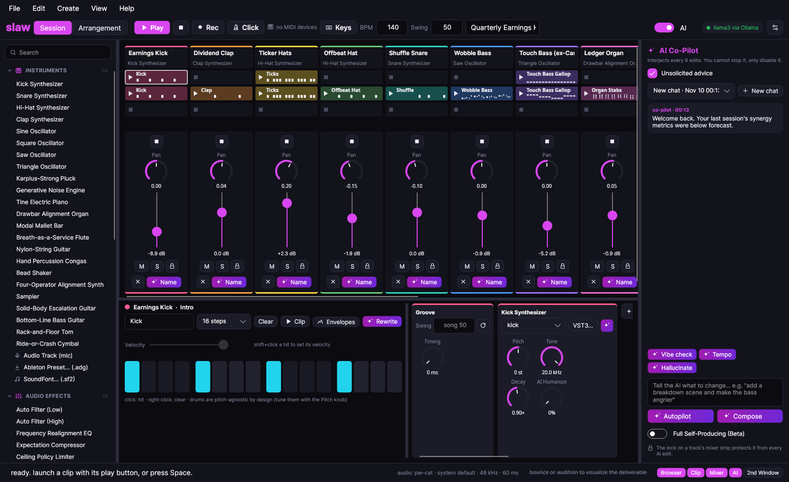
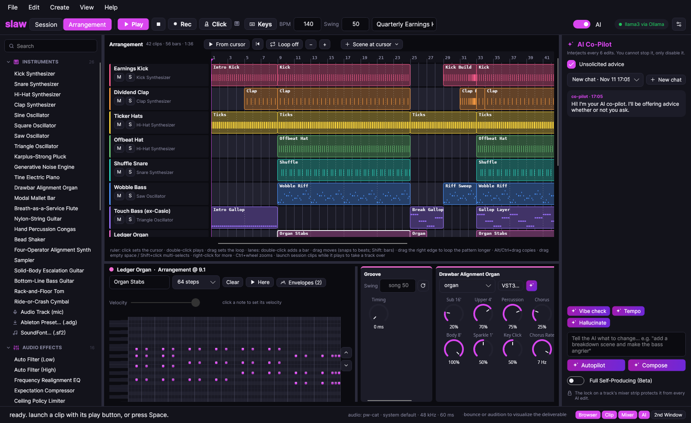
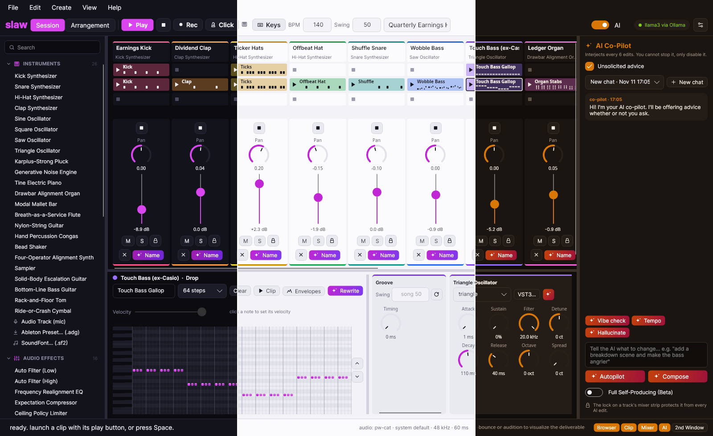

# slaw
### *Beyond Deterministic Production*

> "We didn't reinvent the DAW. We asked an AI to guess what music sounds like."
> — slaw Engineering Blog, Issue 1 (Final)

**slaw** is an AI-native digital audio workstation that transforms your *vibe* into an audible waveform artifact, at inference speed, across every major foundational intelligence provider. It is also a real, working DAW, which nobody on the leadership team can explain.



**slaw is the only DAW built on the insight that your track doesn't need to be *good* — it needs to be *shipped*.**

## What's in the box

- **A session-view studio** in the Ableton shape: clips, scenes, mixer strips, device chains and an arrangement timeline, on Linux, macOS and Windows. A real-time engine means every note, knob and whole-song AI rewrite is heard on the next step.
- **Its own instruments and effects**: synths, an FM electric piano, an organ, drums, a four-operator synth, a parametric EQ and a compressor. Zero samples shipped, because samples would imply someone recorded something on purpose.
- **Your sounds too**: VST3 plugins, SoundFonts, WAV kits, MIDI files and Ableton `.adg` presets. And your voice: record from the microphone against a metronome and count-in, then let autotune move every take into the song's key.
- **AI that can be dismissed**: Autopilot rewrites the song, Full Self-Producing does it in a loop, and a co-pilot interjects unasked. Ollama, OpenAI, Gemini, Claude or any compatible server. Locked tracks are left alone, because boundaries matter. **You can turn the AI off.** Nobody at slopstack labs has ever turned it off.
- **MCP for other AIs**: agents edit the song you have open while it plays, then read back its loudness, tonal balance, likely masking and wrong notes, since none of them can hear it either.
- **Your colours**: three themes ship (dark, light and after-hours), and one of your own is a few lines of JSON, previewed as you pick it.
- **Undo for everything**, including the AI's decisions.



Not every organisation's brand is near-black and magenta. The same studio in all three built-in [themes](wiki/Themes.md):



## Get started

You need the [.NET 8 SDK](https://dotnet.microsoft.com/download). For the AI features, also [Ollama](https://ollama.com) or an API key; everything else works without one.

```sh
./run.sh          # Linux / macOS: builds if needed, starts Ollama, opens the studio
./run.ps1         # Windows, the same
```

Then open something that already works:

```sh
slaw studio examples/synergy-feature-tour.slaw   # one of each feature, and every track name says which
slaw render examples/stakeholder-pump.slaw       # or bounce a song straight to WAV
```

Let an AI in by turning on *Settings → Integrations → Expose the open project over MCP*, then:

```sh
claude mcp add --transport http slaw-studio http://127.0.0.1:47115/mcp
```

Press **Ctrl+Shift+P** (⌘⇧P on a Mac) in the studio to search everything it can do, and **F1** for every shortcut. Installers for Windows and macOS are [built on demand](wiki/Install.md#installers).

## Documentation

| | |
|---|---|
| **Getting going** | [Install and build](wiki/Install.md) · [Command line](wiki/Command-Line.md) · [Examples](wiki/Examples.md) |
| **Making music** | [The Studio](wiki/Studio.md) · [Arrangement, automation and groove](wiki/Arrangement.md) · [Keyboard and mouse](wiki/Keyboard-and-Mouse.md) |
| **Sound** | [Instruments and effects](wiki/Devices.md) · [Samples, SoundFonts, MIDI and recording](wiki/Sounds.md) · [VST3 plugins](wiki/VST3.md) |
| **Automation** | [AI features and providers](wiki/AI.md) · [MCP](wiki/MCP.md) · [Deck control](wiki/Deck-Control.md) |
| **Reference** | [Settings](wiki/Settings.md) · [Themes](wiki/Themes.md) · [Project format](wiki/Project-Format.md) |

The [Circle of Fifths of Inevitability](ROADMAP.md) says where this is going. The [Contributor Excellence Framework](CONTRIBUTING.md) says how to help it get there.

## Star History

<a href="https://www.star-history.com/?repos=slopstack-labs%2Fslaw&type=date&legend=top-left">
 <picture>
   <source media="(prefers-color-scheme: dark)" srcset="https://api.star-history.com/chart?repos=slopstack-labs/slaw&type=date&theme=dark&legend=top-left" />
   <source media="(prefers-color-scheme: light)" srcset="https://api.star-history.com/chart?repos=slopstack-labs/slaw&type=date&legend=top-left" />
   
 </picture>
</a>

---

<sub>This clearly is a joke and only sort of works. I am not responsible for your speakers, your ears, or your career in music.</sub>
